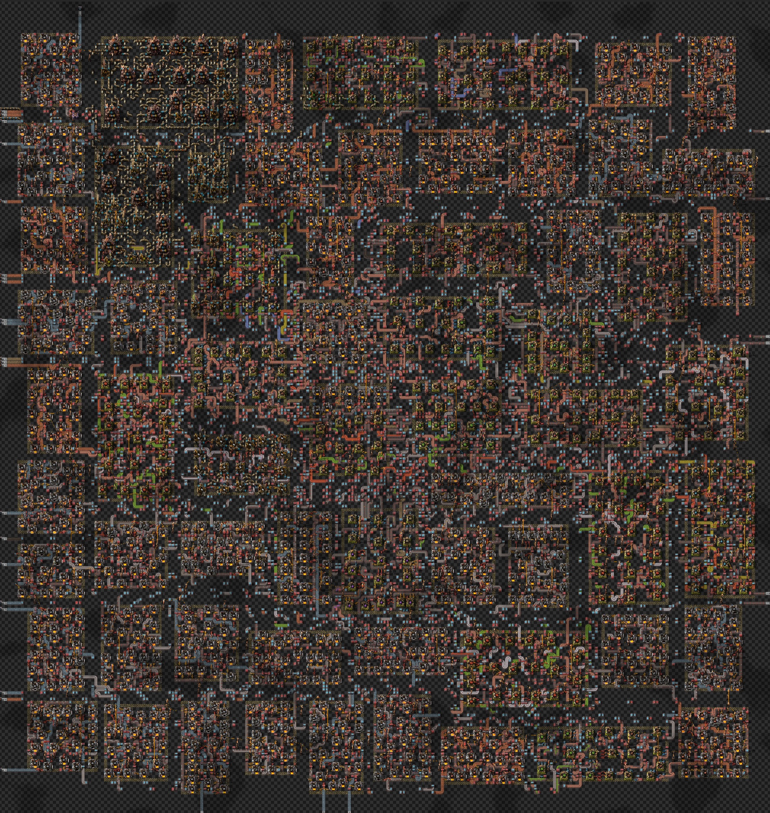
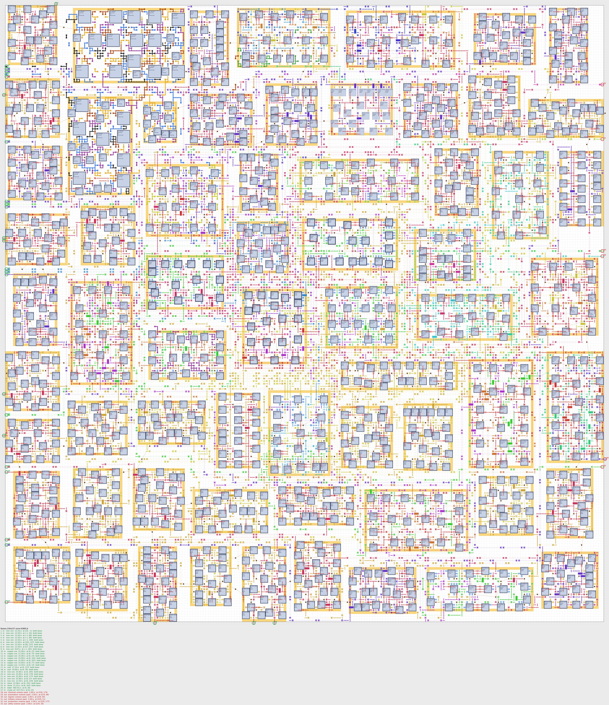
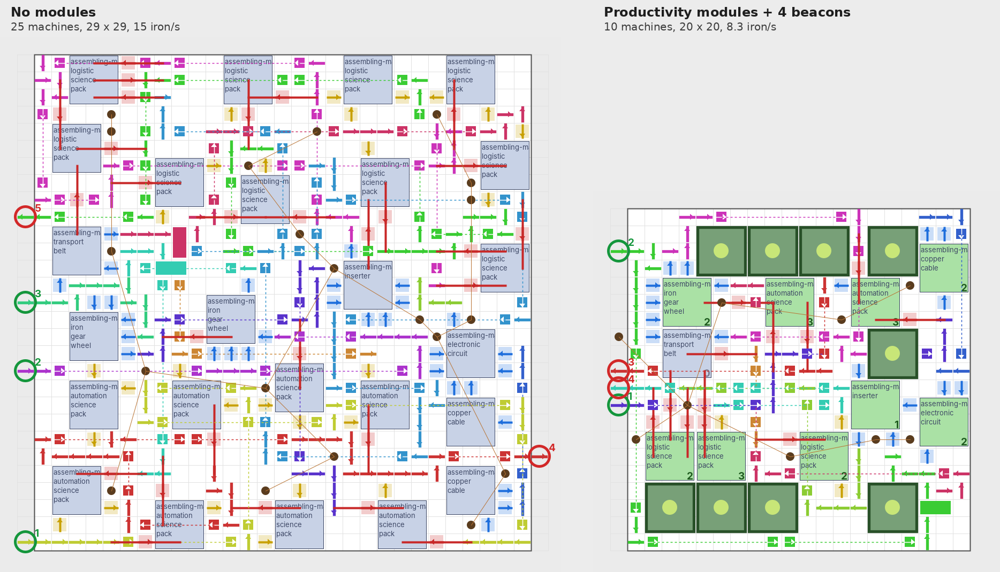
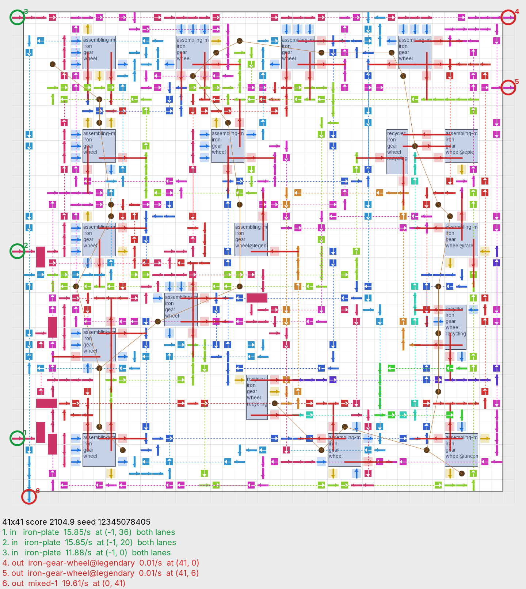
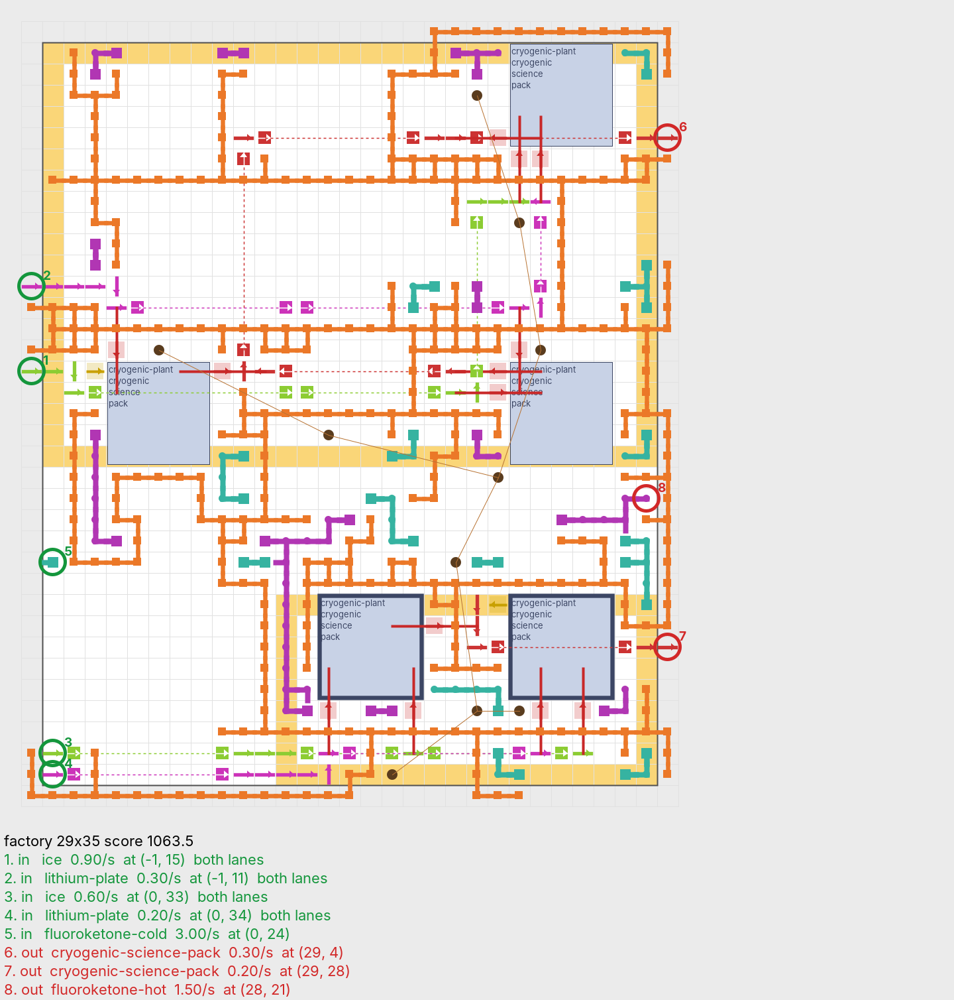
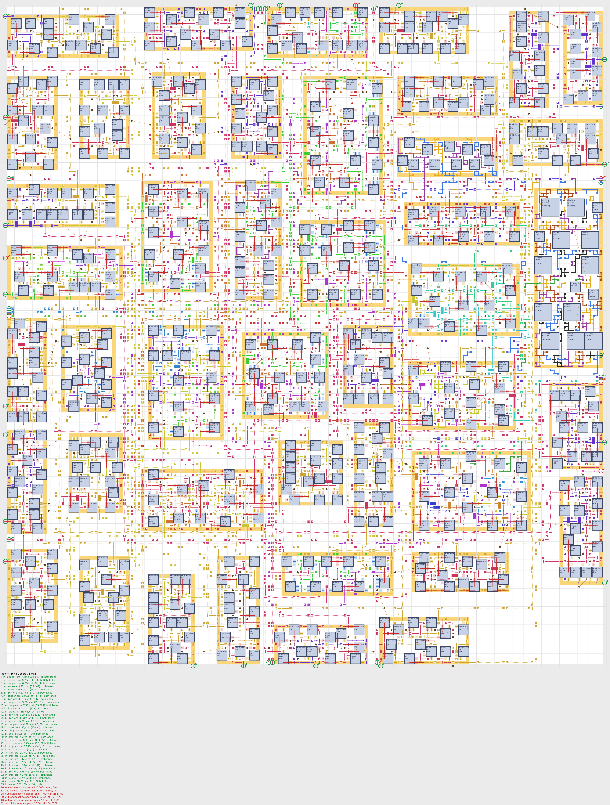
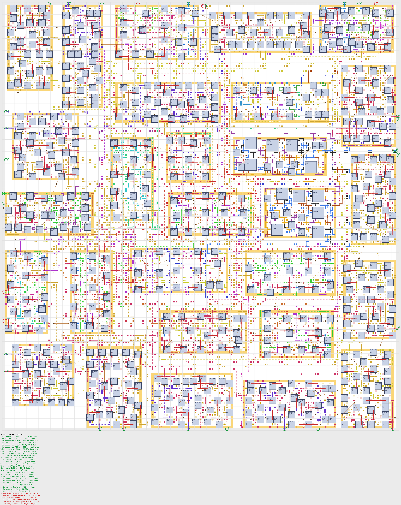
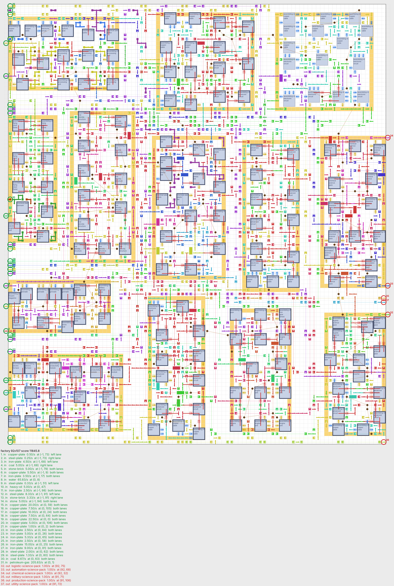
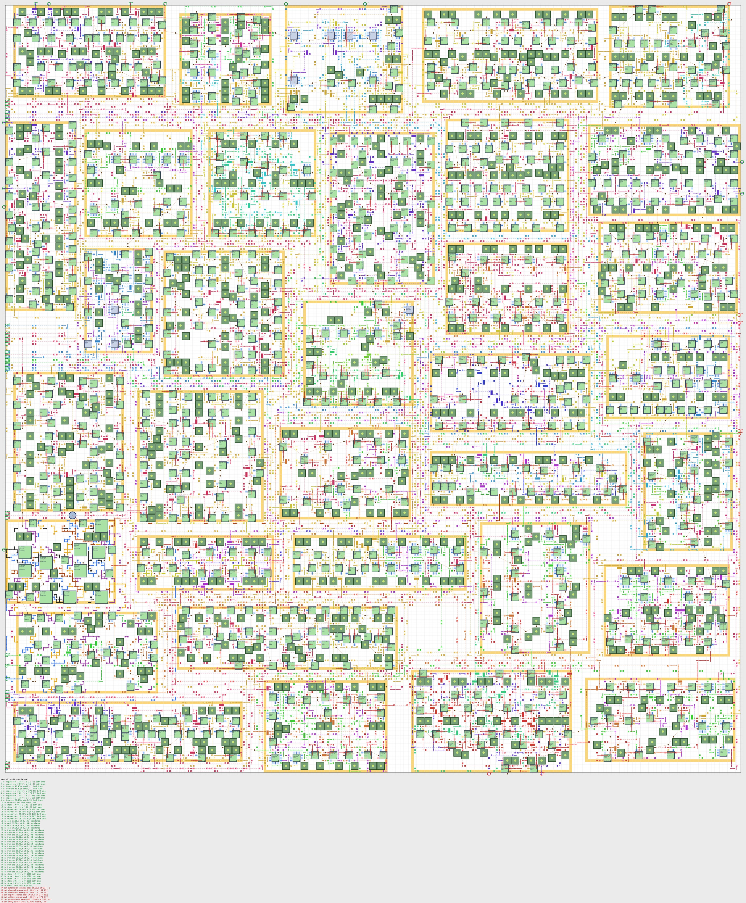
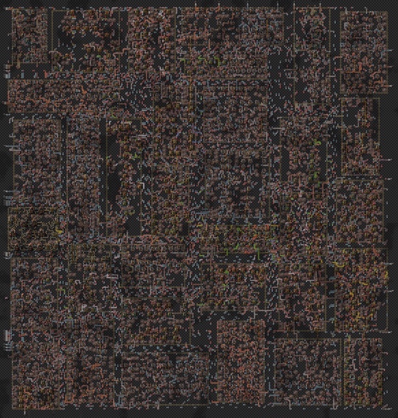

# Factorio layout optimizer v2

> See also: [factorio_optimizer](https://github.com/SeezoCode/factorio_optimizer), the original version, a
CP-SAT bot-mall model that places machines on a macro grid and connects them with requester and provider
chests.

Generates importable Factorio 2.0 blueprints for production blocks. A linear program picks recipes and machine
counts (by-products included), simulated annealing places the machines, a router lays belts (with splitters
and several belts per item), undergrounds, inserters and pipes between them, poles are added, an independent
validator checks the result, and an outer loop shrinks the box for as long as it has time. Inputs and outputs
are ports on the block's edge, listed in `ports.json`, so you connect blocks yourself. Every valid improvement
is written as a blueprint string. Jobs too big for one block are built as a [factory of
blocks](#big-jobs-a-factory-of-blocks).

**Space Age (experimental):** foundries, electromagnetic plants and biochambers work, with their built-in
productivity, research productivity and space-platform jobs (see [Space Age](#space-age)). Recyclers work when a
job asks for them ([recycling](#recyclers-and-mixed-belts)), and leftovers can leave together on one mixed (sushi)
belt; Aquilo's heating is laid with heat pipes ([heat](#aquilo-heat-pipes), dense blocks with a heat lattice,
factories of blocks too). Crushers work only on space platforms. Gleba layouts are the hardest to route, since
every biochamber also needs a nutrient belt; spoilage can be drained ([spoilage](#gleba-spoilage), opt-in).
Machines, beacons and modules can be of any quality, and items of a better quality can be made with quality modules
and recyclers ([quality production](#quality-production), opt-in).

## Examples

Each folder in [docs/examples](docs/examples) has the blueprint string (`best_output_string.txt`, paste it into
Factorio 2.0 with Import string), a render, `ports.json` (where to feed it and where products leave) and the
job file next to it, and most have a screenshot of the layout built in game. All were run with 10 threads
(M5).

Compared with my most compact hand-built layouts, the generated ones take 110–120% of their area. More compute
closes only a little of that; the rest is the algorithm. Hand builds run one belt down a whole column of
machines, put two inputs on one belt, and feed everything from a bus, while the router still treats each item
as separate chains between scattered machines.

| Example | Machines | Box | Search ran | Best layout found after | J*b |
|---------|---------:|----:|-----------:|------------------------:|-----|
| [Red + green science, 0.5/s each](docs/examples/red_green_science) | 10 | 16 × 16 | 5 min | 5 s | [details](docs/examples/red_green_science.json) |
| [Red + green science, 0.5/s each, two items per belt](docs/examples/red_green_science_shared) | 10 | 15 × 15 | 5 min | 2 min 48 s | [details](docs/examples/red_green_science_shared.json) |
| [Chemical science 0.5/s from ore and crude oil](docs/examples/chemical_science) | 43 | 36 × 36 | 15 min | 10 min (36 × 36 first at 5 min 20 s) | [details](docs/examples/chemical_science.json) |
| [Electromagnetic science 1.5/s (Space Age, Fulgora)](docs/examples/electromagnetic_science) (at the bottom of the page) | 36 | 41 × 41 | 15 min | 13 min 35 s (41 × 41 first at 6 min 26 s) | [details](docs/examples/electromagnetic_science.json) |
| [Metallurgic science 4/s (Space Age, Vulcanus)](docs/examples/metallurgic_science) (at the bottom of the page) | 38 | 46 × 46 | 15 min | 14 min 41 s (46 × 46 first at 5 min 34 s) | [details](docs/examples/metallurgic_science.json) |
| [Agricultural science 5/s + carbon fiber 5/s (Space Age, Gleba)](docs/examples/gleba_agricultural_carbon_fiber) (at the bottom of the page) | 43 | 50 × 50 | 15 min | 15 min | [details](docs/examples/gleba_agricultural_carbon_fiber.json) |
| [Six science 1/s each from plates, 13 blocks of at most 15 machines](docs/status/six_science_plates_13_blocks) | 177 | 92 × 107 | 30 min + 10 min compaction | 10 min of compaction | [details](docs/status/six_science_plates_13_blocks.json) |
| [Six science 1/s each from ore, 44 blocks of at most 15 machines](docs/status/six_science_ore_44_blocks) (at the bottom of the page) | 618 | 165 × 182 | 27 min + 10 min compaction | 10 min of compaction | [details](docs/status/six_science_ore_44_blocks.json) |
| [Six science 1/s each from ore, 28 blocks sized by weight](docs/status/six_science_ore_28_blocks) (at the bottom of the page) | 618 | 163 × 176 | 27 min + 10 min compaction | 10 min of compaction | [details](docs/status/six_science_ore_28_blocks.json) |
| [Six science 2/s each from ore, 64 blocks of at most 20 machines](docs/examples/two_science_per_second) ([below](#in-game-2-sciences-for-9-hours)) | 1,220 | 230 × 237 | 7 h 55 min | 7 h 10 min | [details](docs/examples/two_science_per_second.json) |
| [Six science 10/s each from ore with productivity modules and beacons, 34 blocks](docs/examples/ten_science_beacons) (at the bottom of the page) | 959 + 956 beacons | 279 × 291 | 16 h 52 min (10 h 10 min, then resumed twice) | 15 h 19 min | [details](docs/examples/ten_science_beacons.json) |
| [Red + green science 2/s each with modules and beacons](docs/examples/beacons_red_green) ([below](#modules-and-beacons)) | 10–42 | 20 × 20 to 39 × 39 | 4–10 min | | [details](docs/examples/beacons_red_green/beacons_4.json) |

Each render next to the same blueprint built in game. Red + green was generated with belt sharing on
(`lane_sharing`, two items per belt, one per lane), chemical science with it off (one item per belt).


*Red and green science at 0.5/s each (15 × 15): iron and copper plates enter on the west edge, copper on the
left lane of a belt it shares with an item made inside. In the render, belts are coloured per chain and brown
dots are poles.*


### In game: 2 science/s for 9 hours



*All six science packs at 2/s each from ore, coal, stone, crude oil and water: 1,220 machines (834 electric
furnaces, 312 assemblers, 52 chemical plants, 22 oil refineries) in 64 blocks of at most 20 machines, 230 × 237 =
54,510 tiles. It ran for 9 hours in game with everything working.*

The search ran for 7 h 55 min on 10 threads (M5): 4 h 15 min for the blocks (about 4 minutes each), 2 h 12 min
for two extra shapes of every block, then 14 floorplans and compaction; the smallest factory came out of
compaction at 7 h 10 min. The blueprint has 21,508 entities: 8,798 belts, 6,162 undergrounds (2,772 of them
express, for weaving), 2,921 inserters, 884 poles and 187 splitters. It eats 222 iron ore, 159 copper ore, 43
stone and 27 coal per second, plus 427 crude oil and 683 water; most inputs enter on the west edge and the six
packs leave on the east edge.

Twice the rate of the 1/s factories below took 1.97 times the machines and 1.90 times the area of the 28-block
one: 44.7 tiles per machine against 46.4, so the factory of blocks does not lose density as it grows.



### Modules and beacons



*Red + green science at 2/s each, drawn at the same scale. Left: no modules, 25 assemblers in 29 × 29. Right:
four productivity modules in every assembler and up to 4 beacons per machine, 10 assemblers in 20 × 20 with half
the plates in. Dark green squares are beacons; machines in reach of one are green, with the number of beacons in
range in their bottom-right corner (each has as many as its own rate needs).*

The same job, red + green science at 2/s each, with four productivity-module-3 in every assembler (speed-module-3
where a recipe takes no productivity) and beacons of two speed-module-3. The beacon runs searched for 4 minutes,
the two without beacons for 10 (they have far more machines); every box is the smallest that routed, the next size
down failed on every try. Power counts assemblers and beacons only: average with each machine working the share
of time its rate needs, peak with every machine running flat out.

| Setup | Machines | Beacons placed | Box | Iron / copper in (per s) | Belts | Inserters | Power (avg / peak) |
|-------|---------:|---------------:|----:|-------------------------:|------:|----------:|-------------------:|
| [No modules](docs/examples/beacons_red_green/no_modules) | 25 | 0 | 29 × 29 | 15.0 / 5.0 | 298 | 86 | 8.9 / 9.7 MW |
| [Modules, no beacons](docs/examples/beacons_red_green/modules_only) | 42 | 0 | 39 × 39 | 8.27 / 2.52 | 542 | 129 | 57.8 / 66.4 MW |
| [Modules, 1 beacon per machine](docs/examples/beacons_red_green/beacons_1) | 13 | 4 | 23 × 23 | 8.27 / 2.52 | 128 | 42 | 20.5 / 32.0 MW |
| [Modules, 2 beacons per machine](docs/examples/beacons_red_green/beacons_2) | 11 | 7 | 22 × 22 | 8.27 / 2.52 | 143 | 38 | 19.3 / 30.9 MW |
| [Modules, 4 beacons per machine](docs/examples/beacons_red_green/beacons_4) | 10 | 9 | 20 × 20 | 8.27 / 2.52 | 112 | 34 | 19.6 / 30.3 MW |

- Productivity cuts the plates needed by about half, whatever the beacons.
- Productivity modules alone are the worst choice: they slow each machine to 40 %, so the block needs 42 machines,
  6.5 times the power and almost twice the area of the one without modules.
- Beacons win back the speed. Area shrinks by 37 %, 42 % and 52 % with 1, 2 and 4 beacons per machine, but each
  step adds less: 2.0 weakens every beacon to $1/\sqrt{n}$ when $n$ reach a machine, so $n$ beacons give $\sqrt{n}$
  times one. Power stays about the same from 1 to 4 beacons, since fewer machines offset the extra beacons.
- Fewer beacons are placed than machines × `per_machine`: machine counts are rounded up, so each machine gets only
  what its own rate needs (some none), and one beacon usually serves several machines. In renders, machines in
  reach of a beacon are green and show the number of beacons in range in their bottom-right corner.

## How to run

Java 25 (LTS) with Gradle 9.8.2 (the wrapper downloads it) and Kotlin 2.4; it runs on macOS, Linux and
Windows. Point `JAVA_HOME` at a JDK 25, for example on macOS:

```sh
export JAVA_HOME=$(/usr/libexec/java_home -v 25)
```

on Linux (Debian/Ubuntu package `openjdk-25-jdk`, or any JDK 25 build such as Temurin or Zulu), point it at
the JDK that `java` runs from:

```sh
export JAVA_HOME="$(dirname "$(dirname "$(readlink -f "$(command -v java)")")")"
```

Rendering needs FreeType and fontconfig, which minimal Linux images leave out (Debian/Ubuntu:
`sudo apt-get install -y libfreetype6 fontconfig fonts-dejavu-core`).

On Windows use `gradlew.bat` instead of `./gradlew`.

Or open the folder in a GitHub Codespace or in VS Code with the Dev Containers extension: `.devcontainer/` uses
the Java 25 image (`JAVA_HOME` is already set), installs the font libraries and compiles everything on
creation.

Run a job (the job file is a classpath resource name or a path):

```sh
./optimize --config=src/test/resources/jobs/t3.json
```

`./optimize` (`optimize.bat` on Windows) builds whatever changed and runs the program in your terminal, which a
factory of blocks needs for its [live view](#watching-and-steering-a-factory-run). `--ram=12g` sets the Java heap
(default 6g; on Windows `set OPTIMIZE_RAM=12g` first), e.g. `./optimize --ram=12g --config=job.json`. `./gradlew run
--args="--config=..."` works too, but Gradle runs the program without a terminal, so you get plain output (the
control file still works).

Results go to `src/main/resources/solves/<time> - sa/` (or `--out=<dir>`):

| File | Contents |
|------|----------|
| `best_output_string.txt` | Blueprint string of the best layout so far |
| `best_blueprint.json` | The same blueprint as readable JSON |
| `test_output_string.txt` | The same blueprint with test feeds on its ports, for trying it in the editor (see below) |
| `test_feeds.txt` | Ports the test copy could not feed (`every port fed` when there are none) |
| `best.png`, `renders/` | Render of the best layout, and one per improvement |
| `allSolves/` | Blueprint string of every improvement |
| `scores.tsv`, `score_vs_time.svg` | Score log and graph |
| `plan.json` | Stage 1 output: machines, terminals, nets and rates |
| `ports.json` | Where each input and output enters or leaves the block (tile, edge, item, rate) |
| `log.txt` | Search log |

Ctrl-C stops the search and rewrites the best result first. Other flags:

- `--print-tuning`: every tuning knob with the value the job uses.
- `--tuning=<file>`: a tuning file instead of the built-in defaults.
- `--calibrate=<job>,<job>,... --budget=<s>`: refits `tuning.json` from short searches.
- `--verify-kit=<dir>`: in-game check blueprints (see [docs/VERIFY.md](docs/VERIFY.md)).
- `--render=<dir>`: redraws `best.png` of an output folder from its blueprint and `ports.json`.
- `--resume=<dir>`: continues a factory-of-blocks run in that output folder. The split and every block's best
  layout were saved in `<dir>/resume/`; blocks without one are searched, and the others keep shrinking from where
  they were for the time given, then the factory is stitched and validated again. Useful after stopping a run, to
  give a run more time, or to re-stitch finished blocks with newer code. It uses the job saved there unless
  `--config` is given. A bare `--resume` continues the run in `--out`, so the same command with `--resume`
  added works:

  ```bash
  ./optimize --ram=12g --config=job.json --out=solves/big --resume
  ```

  It stops with a message, instead of starting afresh, when nothing is saved in the folder, or when the job's
  plan has changed since (other targets, rates, modules or beacons give other machines, and the saved split no
  longer fits).
- `--until-stopped`: a factory of blocks searches its blocks until stopped (see below) instead of until the
  time budget; the final factory is stitched after the stop.
- `--plain`: line-by-line output instead of the live view.

### Watching and steering a factory run

(The live view needs the program in a terminal: start it with `./optimize`, not `./gradlew run`.)

A factory of blocks first gives every block one layout and stitches a preview factory from them (within a few
minutes even for hundreds of machines; it is saved like any result, so `best.png` shows it), then keeps shrinking
blocks in turns until the time budget is spent or you stop it, stitching a new preview whenever the blocks have
shrunk enough. In a terminal it shows a live view:

```
out   12:41 elapsed, 27:19 left   2 lane(s) on 4 thread(s)
factory 163x176 (28688 tiles), stitched 1:02 ago   refining

 thr  block  mach  weight   size     first    turns  better ago   spent   state
 [2]      1    29    29.0   34x23    46x31        4        0:14    4:10   refining *
 [ ]      2    29    29.0   34x23    46x31        3        2:31    3:05   refining
 [ ]      3    17    27.4   28x28    38x38        6        6:02    5:40   parked
 ...
q stop  Q stop now  s stitch  +/- limit 5 min  u no limit  p pause  arrows select  f focus  x skip  l/L lanes
```

`thr` is the number of threads on a block right now, `first` its first layout, `better ago` the time since it last
got smaller (or better at its size), `*` marks blocks that set the factory's width or height (shrinking any other
cannot shrink the factory). Search time is shared fairly: the row with the least time for its weight goes next,
weight 2 for `*` rows (a block's shape variants count as the block), 1 for the others, a fifth of that for parked
rows. A block is parked after `park_after` turns without improving. Keys: `q` stops after the current turns and builds the final
factory, which the view keeps showing (`q` twice, `Q`, or `q` while the final factory is built: stop at once,
keeping the best factory so far), `s` stitches a preview now, `+`/`-` move
the limit by five minutes, `u` removes it, `p` pauses, the arrows (or `j`/`k`) select a row, `f` gives it every
thread and runs nothing else until you press `f` again (a turn it is in on fewer threads is cut short and started
again on all of them), `x` skips it, `l`/`L` add or remove a lane. Shape variants have rows of their own
(`3 x0.6`). When the time is up, focus, pause and skip end for blocks that still have no layout, so the run always
finishes. Everything also goes to `factory.txt` and each block's
`log.txt`.

The same controls work without a terminal: write a command into `<out>/control` (`stop`, `stop now`, `stitch`,
`pause`, `resume`, `limit +600`, `limit -300`, `limit 3600` (seconds from the start), `limit none`, `focus 3`,
`focus off`, `skip 3`, `unskip 3`, `lanes 2`; `3:1` is block 3's first shape variant), e.g. `echo "limit +600" > out/control`. `<out>/status.json`
holds what the live view shows, refreshed every second.

Renders show each machine's name and recipe, and mark every input (green) and output (red) with a number on its
tile, listed underneath with item, rate and tile. Input belts also say which lane the item goes on: "both lanes"
for a belt of its own, "left lane" or "right lane" when it shares the belt with a second item, seen looking
along the belt into the block (for a belt entering from the west, left is the north side).

## Job config

Unknown keys are an error. Everything except `targets` has a default.

```json
{
  "targets": [{ "name": "electronic-circuit", "amount": 2.0 }],
  "machine": "assembling-machine-3",
  "machines": ["assembling-machine-3", "electric-furnace", "chemical-plant", "oil-refinery", "centrifuge"],
  "belt_tier": "fast",
  "weave_tier": "auto",
  "lane_sharing": false,
  "inserters": { "allowed": ["inserter", "long-handed-inserter", "fast-inserter"], "belt_pickup_derate": 0.7 },
  "research": { "inserter_capacity": 0, "productivity": { "steel-plate": 0.2 } },
  "raw_resources": null,
  "sources": [
    { "name": "iron-plate", "edge": "west", "from": 0, "to": 20 },
    { "name": "copper-plate", "x": -1, "y": 12 },
    { "name": "crude-oil", "edge": "south" }
  ],
  "outputs": [{ "name": "electronic-circuit", "edge": "east" }],
  "box": { "aspect": 1.0, "fixed_width": null, "start_size": null, "max_size": 80 },
  "sinks": { "mode": "port" },
  "fluids": { "mode": "pipes" },
  "power": { "mode": "set-cover", "pole": "medium-electric-pole", "allow_outside_ring": true },
  "beacons": { "mode": "lattice", "beacon": "beacon", "modules": ["speed-module-3", "speed-module-3"], "per_machine": 2,
               "machine_modules": ["productivity-module-3", "productivity-module-3", "productivity-module-3", "productivity-module-3"],
               "fallback_module": "speed-module-3", "recipes": null, "pitch": null,
               "quality": "normal", "module_quality": "normal" },
  "search": { "time_budget_s": 300, "seeds_per_size": 3, "threads": 4, "seed": 12345, "verbose": true },
  "score": { "belt": 0.3, "underground": 1.0, "inserter": 0.2 },
  "test_mode": false,
  "templates": true,
  "blocks": { "max_machines": 120, "size_by": "weight", "overflow_cost": 1.0, "hard_max": 1.5,
              "lanes": null, "park_after": 4, "restitch_share": 0.03,
              "split_at": ["iron-plate", "copper-plate"], "corridor": 4,
              "link_belt_share": 0.9, "belt_weight": 0.0, "split_at_weight": 0.1, "block_time_share": 0.9,
              "link_cost": 1.0, "fluid_link_cost": 3.0, "block_cost": 4.0, "aspect_weight": 0.5, "wire_weight": 2.0,
              "pass_through": false, "lane_pairs": true, "rotate": true, "floorplan_tries": 3,
              "compact_s": null, "shape_variants": [], "shape_variant_s": null,
              "compact": true, "repack": false, "repack_share": 0.25, "merge": false, "merge_share": 0.3,
              "templates": true, "template_share": 0.25, "template_ingredients": 4, "template_min_machines": 4, "template_columns": 1,
              "shared_outputs": false },
  "reserved": [{ "w": 10, "h": 8, "corner": "south-east" }],
  "ports_on_ring": true,
  "marker_tile": "hazard-concrete-left",
  "recycling": { "mode": "off", "void_items": [] },
  "mixed_outputs": [{ "items": ["solid-fuel", "stone", "ice"], "edge": "south" }],
  "heat": { "mode": "off", "edge": "any", "poles": false, "ports": 4 },
  "tuning": { "route": { "p_mult": 1.1 }, "place": { "beta2": 1.0 } }
}
```

- Amounts are items (or fluid units) per second. Anything listed in `sources` enters the block at a port (a
  fixed tile, an edge segment, or `"edge": "any"`); everything else is made inside from ores, crude oil and
  water, which enter at ports anywhere on the edge. A port one tile wide carries one belt, which branches with
  splitters to all its consumers; give a busy input a few tiles of edge so it can enter on several belts.
  Fluid ports may touch: the generator starts them with pipe-to-ground, which you feed through its open side.
- Products and surplus by-products leave through output ports (`outputs` pins their edge; otherwise the
  generator picks one and reports it in `ports.json`). `"sinks": {"mode": "chest"}` puts products into chests
  instead, as in v1.
- Oil cracking takes only what is left over: wherever heavy (light) oil is cracked and something else also uses it
  (lubricant, or oil leaving the block), a storage tank goes on that oil's pipes with a red wire to the cracking
  plants, which work only while the tank is more than half full (`fluids.surplus_only`, recipe -> fluid, `{}` turns
  it off; `fluids.surplus_level`). Machine counts are rounded up, so uncontrolled crackers run faster than the plan
  needs, starve lubricant and fill the petroleum pipes until the refineries stop. The tank reads its own contents,
  which follow the fill level of the whole pipe network, so the threshold does not depend on pipe length.
- `beacons` (optional) adds modules and beacons, placed much like electricity poles. `machine_modules` go in every
  electric machine's own slots; one the recipe refuses (productivity on belts, inserters…) becomes `fallback_module`,
  or the slot stays empty. Machines of `recipes` (default: every one that takes beacon effects) are planned with
  `per_machine` beacons of `modules`, using the 2.0 rules: speed × max(0.2, 1 + Σ machine modules + 1.5 · √n · Σ one
  beacon's modules), productivity from the machine's own modules, so the plan needs fewer machines and less input.
  Because machine counts are rounded up, many machines need fewer beacons than planned; each needs only enough
  for its own rate. In `"lattice"` mode (default) rows of beacon spots are kept free before placement, like the
  pole lattice (every `pitch` tiles, by default room for a row of machines on each side, or one row between two
  beacon rows when `per_machine` is above 4), and the placer pulls machines next to them; after routing, beacons
  that serve nobody go and machines still short get beacons on free tiles. `"set-cover"` places them only after
  routing (rerouting around machines left short, falling back to the lattice). Beacons are powered, the validator
  counts the beacons in range of every machine, and the blueprint requests the modules into their slots.
- **Quality of the buildings.** `quality` is the crafting machines' quality (a legendary assembler 3 crafts at
  3.125), `beacons.quality` the beacons' (distribution effectivity 1.5 + 0.2 a level, 2.5 legendary) and
  `beacons.module_quality` every module's (bonuses × (1 + 0.3 · level), ×2.5 legendary; penalties as they are).
  The plan counts machines with them, and the blueprint asks for machines, beacons and modules of that quality;
  machines still craft normal items (recipe quality normal). The module rule is marked VERIFY (v27).
- Fluids are routed in pipes and pipe-to-ground (`"fluids": {"mode": "infinity-pipe"}` puts an infinity pipe on
  every fluid connection instead, `"manual"` leaves the connection tiles free).
- `box.max_size` caps the box (the side of a square of the box's area): the search starts there and, if it
  fails, keeps trying new seeds at that size instead of growing. `box.start_size` sets where it starts
  (default: `max_size`, else twice the estimate from machine area). Either way it then shrinks the box.
- `weave_tier` is the second underground tier that may cross under the main tier's undergrounds ("auto":
  express under fast belts; "none" turns weaving off). `lane_sharing: true` lets two items share a belt, one
  per lane (opt-in until the drop-lane facts are checked in game, see docs/VERIFY.md).
- `belt_stack_size` (Space Age, 1–4, default 1: off) stacks items on belts: every inserter dropping onto a belt is a
  stack inserter and items coming in are taken as stacked, so a belt carries that many times its items (a lane
  is counted in slots: a stack takes one, an item another inserter dropped takes one alone). See
  [Belt stacking](#belt-stacking).
- `spoilage.mode` (Gleba, "off" or "drain", default off) drains what spoils at belt ends and keeps machines from
  clogging with it; see [Gleba: spoilage](#gleba-spoilage).
- `quality_production` makes items of a better quality (targets like `"iron-gear-wheel@legendary"`), with quality
  modules and recyclers; see [Quality production](#quality-production).
- `research.inserter_capacity` (0–7) sets inserter hand sizes; `machines` picks one machine per recipe category.
- `research.productivity` adds research productivity per recipe on top of the machine's own (+50% in a foundry,
  electromagnetic plant or biochamber), capped at the recipe's maximum. Rates and machine counts follow from it.
- `raw_resources` lists what may enter without a listed source. By default that is ores, stone, coal, wood, crude
  oil, water and fish; `[]` means only `sources` enter (a space platform).
- `reserved` keeps empty areas for building by hand later: `w` × `h` at a `corner` (`north-west`, `north-east`,
  `south-west`, `south-east`; by default the corners in turn) or at a fixed `x`, `y`. Nothing is placed there,
  the box grows to fit, and the border is marked. In a factory of blocks they sit east of the blocks.
- `ports_on_ring` (default on) moves every input and output one tile out of the box, onto the ring around it,
  so ports stand out. `marker_tile` is the floor tile drawn around blocks and reserved areas in the blueprint
  (`"none"` for no tiles, e.g. on a space platform, where concrete cannot be placed).
- Every best layout also comes as a **test copy**, `test_output_string.txt`: the same blueprint, unchanged
  inside the box, with a feed on every port. An item input gets a loader pointing at its belt with an infinity
  chest of that item behind it, an item output a loader into a void infinity chest, and a fluid port an infinity
  pipe (a drain for outputs). Each feed runs straight out from its port, so ports side by side all fit. Paste it
  in the editor (`/editor`; loaders and infinity chests are editor items), add power (an
  electric-energy-interface), and it runs at once; production statistics (P) show the output rates. A belt
  carrying two items, one per lane, gets the inserter feeder of `test_mode` instead, where there is room.
  `test_feeds.txt` lists any port that got no feed.
- `test_mode` builds the feeds into the search instead: inputs from infinity chests with inserters, outputs into
  void chests, ports spaced out so every feeder fits. The layout differs from the real one; the test copy above
  is usually what you want.
- `templates` (on by default): a job of one recipe whose machines a ready-made column holds (see
  [Templates](#templates-ready-made-columns)) starts with that column as its best layout, and the search then tries
  smaller boxes only, so it never ends with a larger layout than the column. Not with `test_mode`, `reserved`,
  `forbidden_tiles` or a fixed box width or height.
- `tricks` toggles individual techniques (I1–I13, B1–B14, F1, F2, P1, P2, H1); v1 ones are on by default. B14, on by
  default, is the dead-end splitter pickup: a splitter on a belt whose second half leads nowhere, so an inserter
  beside the belt picks from that half (or a splitter at the end of a belt, picked from on both halves, up to five
  inserters). It lets a chain serve a consumer without running past its access tile; `route.stub_cost` prices it on
  top of `route.splitter_cost`. On chemical science at 37 x 37 it routed 2 of 6 seeds against 0 of 6 without it, at
  38 x 38 6 of 6 against 3 of 6.
- `recycling`, `mixed_outputs` and `heat`: see [Space Age](#space-age).
- The old CP-SAT fields (`forbidden_places`, source `force`) are still accepted so old job files load, but do nothing.

### Big jobs: a factory of blocks

With a `blocks` section, a job with more than `max_machines` machines is built as several blocks connected by
belts and pipes, in one blueprint:

1. **Split.** The whole job is planned once, so every rate is exact, then its machines are divided into blocks.
   `max_machines` is a target, not a cap: machines count by how hard they are to connect (half their belt
   inserters plus 0.75 per pipe connection, at least 1, so a furnace with one input and one output counts 1 and a
   many-input assembler 2–3), and a block aims at `max_machines` machines of a typical recipe. It may grow past
   that at a price (`overflow_cost` ports for 20 % over, growing with the square) but never past `hard_max` times
   it. Simple blocks such as smelting columns grow, mixed ones stay about as they were, and each block's share of
   the search time follows its weight. `belt_weight` (default 0) adds that much weight per belt's worth of items a
   machine takes or makes, for blocks of machines that fill belts (foundries casting cable); on a ten-science job
   with foundries 1 to 2 changed the cable blocks little (6 foundries and 9 assemblers to 5 and 8), since the
   typical recipe gets heavier too. `"size_by": "machines"` keeps the old hard cap of `max_machines`
   machines. The split pays for what it cuts: every item a block makes more or less of than it uses
   is a port on that block and a belt (or pipe) through the corridors, so it costs `link_cost` per belt
   (`fluid_link_cost` per pipe port), plus a little per belt's worth of rate, plus `block_cost` per block.
   Items in `split_at` cost `split_at_weight` times as much (plates are natural cut points). A greedy merge of
   same-recipe groups gives a first split; simulated annealing then moves single machines, swaps two, and moves
   whole recipe groups between blocks. `factory.txt` reports the ports of the split against the greedy one.
   Machines joined by pipes may end up in different blocks: oil processing no longer has to be one block.
   Machine counts are rounded up, so most machines have room to spare; a linear program then lets machines of
   one recipe in different blocks run at different rates (within their crafting speed and planned inserters) so
   each block makes what it uses, instead of trading slivers like 0.06 cable/s on a belt of their own. The split
   kept is the one (greedy or annealed) that is cheapest after this; `plan_rebalanced.json` has its rates.
2. **Plan the floorplan.** The blocks, with shapes estimated from their machines' area, are arranged by
   simulated annealing over sequence pairs: any arrangement, not just rows. It minimises the factory's area,
   its distance from the job's `box.aspect` (`aspect_weight`), and the length of the belts between blocks
   (`wire_weight` per tile, to the factory's edge for inputs and outputs). This plan decides each block's shape
   and which side of the block each port goes on: towards the block it trades with, or towards the edge the job
   gives the item. A block that ends up on an allowed edge (`"any"`, or a whole side) takes that input or output
   straight through it; the others run through the corridors to the edge.
3. **Blocks.** Every belt between two blocks is a link with an exact rate (at most `link_belt_share` of a belt).
   With `pass_through`, what one supplier (a block, or the factory edge for raw inputs) sends to several blocks
   passes through them in a chain: the nearest block keeps its share and passes the rest on to the next, as long
   as the chain fits one belt and each next block is nearer the chain's end than the supplier. It is off by
   default: on six science the belts passing through made blocks bigger than the corridor belts they saved.
   Two items going between the same two blocks that each fit a lane share one belt (`lane_pairs`): the consumer
   takes them on one input belt, and next to the supplier their belts side-load onto it from either side.
   Every fluid traded between blocks gets one pipe tree through the corridors joining one port on each block
   that makes or uses it (and the factory edge, if it enters or leaves there), so any number of blocks can share
   a fluid. Each block is generated on its own, at its planned aspect. Blocks are searched in turns on `lanes`
   lanes side by side (default half of `search.threads`, sharing the threads): one layout each first, then a box
   size at a time from each block's best layout, blocks that set the factory's size getting twice the share, until the time for
   blocks is up (`block_time_share` of the budget, less repack and merge time; the final factory runs after it)
   or the run is stopped. A
   preview factory is stitched as soon as every block has a layout and again whenever their total area has
   dropped by `restitch_share` (see [watching and steering a factory run](#watching-and-steering-a-factory-run)).
4. **Floorplan and stitch.** The finished blocks are arranged again with their real sizes and port positions, each
   block turned in whichever quarter turn packs best (`rotate`; its ports turn with it),
   keeping free space around each block for the corridors (half a `corridor` plus room for that side's ports;
   none on a side whose ports leave the factory straight out, which must stay on the factory's edge). The belts
   and pipes are routed through the corridors. Where routing fails, the block sides near the trouble get more
   room and it tries again; once it routes, lines of corridor that stayed empty are given back, the blocks are
   rearranged with the corridors as measured, and single corridor lines are squeezed out one block side at a time
   while it still routes (for the stitching share of the time budget). This is done from `floorplan_tries`
   different floorplans and the smallest valid factory wins. Poles cover the whole factory and
   the result is validated end to end against the full plan. A pipe port right beside another fluid's pipe is
   left through a pipe-to-ground pair.
5. Rows and columns that only straight belts, straight pipes or underground spans cross are removed
   (`compact`, on by default; the factory is validated again, and kept as stitched if that ever fails).
   Compaction then continues for `compact_s` seconds (default: the stitching share of the budget; `--compact=<s>`
   on the command line): wherever every longest chain of blocks across the factory can lose a padding line, it
   does, as long as the corridors still route; when that stalls, the blocks are floorplanned again from where they
   are with a fresh seed and a lighter price on belt length. Every smaller valid factory is saved on the way.
   With `shape_variants` (e.g. `[0.6, 1.7]`) each block is also searched at its aspect times those factors, as
   rows of their own in the same rotation and at the same priority as their block (only first layouts go to the
   blocks first, so the preview is not held up), and previews and the final floorplan pick the shapes that pack
   best. `shape_variant_s` caps the search time a variant gets at that priority; after it, the variant is parked
   (a fifth of the share; no cap when not set, so each shape of a block gets an equal share).
6. With `repack`, a floorplan of the blocks' real areas with free shapes says which shape each block should have;
   blocks far from it are searched again at that aspect, and the floorplan then picks, per block, the layout that
   packs best. Kept if the factory gets smaller.
7. With `merge`, until the time budget runs out, two neighbouring blocks become one block, searched starting from
   their placements as they lie in the factory. Pairs that trade with each other or share recipes go first,
   lightest first, each searched for about one and a half times what its two blocks had. A full compaction takes
   minutes, so each merge is judged after a short one against the factory after the same short one; merges that
   win are kept and built on, and the result is compacted fully at the end and kept if it beats the best factory
   (a merged block weighs at most 2.5 times the target, or has at most `merge_max_machines` machines with
   `size_by` machines, default twice `max_machines`).

8. **Templates.** With `templates` (on by default) a block of one recipe of machines (any size) with one to four
   solid ingredients and one product (smelting, gears, science packs, engines…) is also offered as a ready-made
   column, next to whatever the search finds; the floorplan picks the layout that packs best, so nothing is forced
   (see [Templates](#templates-ready-made-columns)). The split keeps such recipes in blocks of their own (those with
   at most `template_ingredients` ingredients and at least `template_min_machines` machines), each within what one
   column's belts carry, and their search gets `template_share` of its share of the time, since the template is a
   layout already.
9. **Shared outputs (experimental, off).** With `shared_outputs` the links of one item leaving a block on one side
   share one output port (two or three links, up to a belt's worth): the block has fewer ports to reach, and in the
   corridors a short belt from the port leads to splitters that give each link its own belt. Small factories route
   and validate with it (`FactoryTest`); on six science (28 blocks) it found no valid factory yet: the splitters and
   their belt sit where the corridors are narrowest and wall off a consumer's port. Kept for further work.

Inputs and outputs take the edges in `sources` and `outputs`, belts and pipes alike, as for a single block, with
`from` and `to` counting tiles of the factory as stitched. Factory jobs take edges only, not `x` and `y`.
Reserved areas are placed by the floorplan in their corners. `rows` is ignored now (old job files still load).

Every smaller valid factory is saved as it is found, so stopping the run early keeps the best so far.

The output folder holds the factory (`best_output_string.txt`, its test copy `test_output_string.txt`, `best.png`, `ports.json`, `factory.txt` with the
split, the links, the pipe trees and every stitching step) and each block in `block_<n>/`.

#### Templates: ready-made columns

A block of one recipe whose machines take one to four solid ingredients (fuel counts) and make one product gets a
ready-made column, whatever the machine's size (2x2 furnaces to 5x5). Machines stand in two columns (or one), a
machine's height apart, with belts down the middle, in one of three styles (mw: the machine's width):

```
narrow (2 mw + 4):  |machine|in, out, pole|A|B|in, out, pole|machine|
split  (2 mw + 7):  |B1|out|machine|in|A|in|machine|out|B2|
wide   (2 mw + 8):  |B1|out|machine|in, in|A1|A2|in, in|machine|out|B2|
```

Narrow, for one or two ingredients: belt A carries the ingredients down the middle (two of them a lane each), belt B
the product. On each side one inserter stands next to the belt it serves and a long-handed one reaches across to the
other (left: short from A, long onto B; right: long from A, short onto B), and the third tile is free for a pole.
Twenty electric furnaces take 30 x 10 = 300 tiles, against 441–484 for the searched smelting blocks of the 2/s
factory; eight assembler 3s of red science 13 x 10.

Split, also for one or two ingredients (a classic smelting column): A down the middle, each machine putting its
product out of its other side onto an outer belt (a lane of it). Short inserters only, so it takes machines that
outrun long-handed inserters, or jobs that allow none; and small machines, whose sides have no room for a pole next
to two inserters (twenty stone furnaces, ore and coal a lane each: 22 x 11).

Wide, for three or four ingredients (or two that each need more than a lane): two ingredient belts down the middle
carry up to four items; each machine takes from the nearer with short inserters and from the farther with
long-handed ones, and puts its product out of its other side onto an outer belt. A2 may run the other way to A1, so
each has a header end of its own for its junction. Four engine units take 9 x 14, eight flying robot frames 14 x 17,
four electromagnetic plants of advanced circuits 16 x 19.

A machine gets as many inserters from a belt as its rates need (bulk inserters on a 4x4 electromagnetic plant, two
fast inserters on a fast assembler) as long as they fit along its side, the cheapest that do; the side's other tiles
take poles, and a machine whose sides keep no tile for one gets a row more. Each belt carries what its machines need
of an item (a lane of it, two items to a belt), and each side's machines put no more on their product lane than it
holds.

When one column's belts would overflow, two stand side by side (a double column), sharing their outer product belt,
or the beacons between them: thirty-two red science assemblers on basic belts take 20 x 28 as two narrow columns,
where one wide column would be 14 x 50. A double column needs ports that divide between its columns: an item from
one port goes onto one column's belt and branches off by a splitter to the other's; from several ports, either some
of them bring each column what it needs, or they all merge into one trunk belt that branches after the last merge.
Blocks of up to six machines are also offered one-sided (machines on one side of the belts only).

Short headers above and below the column run the port belts to whichever sides the block's ports are on (a small
belt search; an underground pair costs a tile more than belts over the same distance, so it only crosses other
belts, and straight runs are left where splitters can go). A belt of two ingredients gets them sideloaded from
either side of the belt just above its head, so each lands on a lane of its own whatever lanes it came on; so does
a belt of one item fed from two ports, each within a lane (a port carrying more runs straight into the head, the
others merging into it). Two ingredients coming on one belt already, a lane each (a factory's lane pair), run
straight into their belt's head, lanes kept. More input ports merge into their item's belt through splitters (a
merge only joins a side while it stays within a lane); more product ports branch off through splitters; product
belts without a port of their own meet the others through a splitter or a sideload (or meet first and branch to the
ports after, when the ports' rates are not what each belt carries). What the machines leave of an ingredient passes
on to its output port: out of the end of a belt it has to itself, or branched off its input belt by a splitter (so
any ingredient may pass through, also one sharing a belt; a factory with `pass_through` sends items on through
blocks). When ports sit on both ends of the column a bypass lane along it (one tile wider) carries a belt past the
machines. Every template is validated before it is offered.

A recipe with one fluid ingredient (and no fluid product) gets a pipe down each column's outer side, narrow style
(or a casting column, `|pipe|machine|out|B|out|machine|pipe|`, when the fluid is all it takes): each machine turned
so that its used fluid input faces the pipe and no connection faces the machines above and below it, pipe-to-ground
pairs passing its unused connections (which no pipe may touch), and the header piping the fluid from its port to the
top of every pipe column (under the belts by pipe-to-ground). Six foundries casting iron plates from molten iron take
16 x 15; chemical plants making plastic, batteries or explosives, and assemblers of electric engines (lubricant), get
one too. Fast foundries soon fill a lane: beaconed ones casting cable put out more than a fast lane holds.

Machines planned with beacons get a column of beacons outside each column of machines (16 wide narrow, 20 wide):
units of beacon, pole row, beacon, placed so every machine has the beacons its rate needs (with the default two per
machine, 2–4 each), the machines with their own modules. Biochambers take no column (their nutrients spoil).

In a factory, `template_ingredients` (default 4) and `template_min_machines` (default 4) pick the recipes the split
keeps in blocks of their own so they get a column; a block that happens to hold one recipe gets one anyway. The split
also keeps each such block within what one column carries: a recipe whose belts would overflow one column is split
over several blocks, each a column (57 beaconed advanced circuit assemblers on fast belts: blocks of at most 13, as
copper cable fills a belt). A recipe whose column holds fewer than half of `max_machines` (and not all its machines)
stays free to mix instead: many small blocks of it cost more links than their columns save. With `template_columns`
2 (default 1) the split sizes them for a double column instead: fewer, larger blocks, which get a column only where
their ports divide between the two (else they are searched). A job in one block starts
from its column (top-level `templates`, on by default) and searches only smaller boxes.

Six science at 1/s each from ore, 28 blocks sized by weight (`docs/status/six_science_ore_28_blocks.json`, 1600 s
plus 600 s of compaction, 2 threads each, same machine): **26,544 and 26,712 tiles in two runs with templates
against 29,928 without** (about 11 % smaller; an early version that gave a column to 7 of the 14 smelting blocks made
27,722, and one before the validator fix below 26,970). That 26,970 run rejected 20 factories for an iron lane over
capacity in front of a steel column fed by three smelting blocks: the validator split each upstream splitter by all
the demand reachable below each side, which counted the steel column's whole draw behind every one of its three
inputs. It now splits by what the max flow sends through to the consumers below each side, and the two runs since
rejected none.

With columns for two to four ingredients too (same job and machine, two runs at a time): **24,180 tiles** against
26,880 with single-ingredient columns only (35 blocks against 28: the split keeps 16 recipes apart). With lane pairs
(two ingredients on one belt from another block), input ports over a lane and the header search preferring belts,
27 of the 35 blocks got a column (all single-recipe blocks but production science, whose rails outrun a long-handed
inserter): **23,405 tiles**; a second run's final stitch did not route on any of its three floorplans (two corridor
conflicts each) and kept a 25,428-tile preview, and resuming it (`--resume`, 200 s) stitched the same blocks into
**23,103 tiles**. With columns for any machine (split, one-sided, double and piped columns, ingredients passing on,
blocks kept within what one column carries): **22,356 tiles** (35 blocks again; the chemical plants making plastic
get a piped column). Keeping every recipe a column holds apart, even with one or two machines, split the small T3 job
into four blocks instead of two, hence `template_min_machines` 4. `TemplateDiagTest` (`TEMPLATE_DIAG=<factory output dir>`,
`TEMPLATE_JOB=<job>`) says why a block got none; `TEMPLATE_DEBUG=1` traces the header search.

### Space Age

The foundry, electromagnetic plant and biochamber are supported (their sizes and fluid connections come from
the 2.0 game data). The crusher works on space platforms only. The cryogenic plant is placed like any other
machine; Aquilo's heating comes from [heat pipes](#aquilo-heat-pipes). List them in `machines`, in the order you
prefer them for recipes several machines can make. The planner counts their
built-in productivity, a biochamber burns nutrients like a furnace burns coal, and a machine with several
products (asteroid crushing returns part of its chunk) gets one filtered output inserter per product.

There is no special mode for space platforms; the normal options describe one:

```json
{
  "targets": [{ "name": "iron-gear-wheel", "amount": 2.0 }, { "name": "copper-cable", "amount": 4.0 }],
  "machines": ["crusher", "electric-furnace", "assembling-machine-3"],
  "raw_resources": [],
  "sources": [{ "name": "metallic-asteroid-chunk", "edge": "west" }],
  "forbidden_recipes": ["metallic-asteroid-reprocessing"],
  "research": { "productivity": { "iron-gear-wheel": 0.1 } },
  "box": { "fixed_width": 24, "max_size": 40 },
  "forbidden_tiles": [{ "x": 0, "y": 0, "w": 8, "h": 8 }],
  "reserved": [{ "w": 6, "h": 6, "corner": "north-east" }],
  "marker_tile": "none",
  "power": { "pole": "medium-electric-pole" }
}
```

#### Quality production

With `"quality_production": {}` targets may name a quality, `"iron-gear-wheel@legendary"` (normal keeps the plain
name), and so may `outputs`. Every machine making what they need takes `modules` (four quality modules 3 by default,
of `module_quality`), so a craft comes out one tier better with its quality chance and each further tier with 10 %
of that, the 2.0 way: four normal quality modules 3 give 10 %, so of a machine's gears 90 % are normal, 9 %
uncommon, 0.9 % rare. Items of each quality are items of their own to the planner, the router and the validator
("iron-plate@rare"), and every recipe in the targets' chain gets a variant per quality that takes ingredients of
that quality. With `recycle` (default) recyclers with `recycler_modules` take what is not wanted back to a quarter of
its ingredients, of that quality or better, and the planner loops items through them to climb. What leaves and is
not a target (the other qualities) shares one mixed belt on `leftovers`; such leftovers leave almost free in the
plan, or it would sooner turn them into something else. The blueprint sets each machine's recipe and recipe
quality, and filters inserters by quality (only that quality).

For 0.01 gears/s from normal plates (`QualityTest`): rare gears take 2.22 plates/s without recycling, 1.47 with
(3 assemblers and a recycler); legendary gears 200 plates/s and 50 assemblers without, 43.6 plates/s, 15 assemblers
and 3 recyclers with. A block of 0.2 uncommon gears/s routes and validates at 14 x 14, an inserter taking only the
uncommon gears to the port. The quality chance of a module effect (0.25 is 2.5 %) is marked VERIFY (v28). In a
factory of blocks each block hands its leftovers to the edge: straight out on `leftovers` where the block touches
it, else through the corridors to the nearest edge (mixed belts of two blocks are not merged).

Legendary gears at 0.01/s with recycling ([job](docs/examples/quality_legendary_gears.json)) route as one block at
41 x 41 in 20 minutes: 11 assemblers make gears of every quality from normal plates, three recyclers take the
uncommon, rare and epic ones back to plates of that quality or better, four assemblers (one per quality, legendary
plates included) make gears from those, and the legendary gears leave east; the normal gears (19.6/s) and the rest leave on the mixed belt at the bottom left.



#### Gleba: spoilage

With `"spoilage": {"mode": "drain"}` what spoils is drained instead of being left to jam belts and machines. Items
that spoil (fruit, mash, jelly, bioflux, nutrients, agricultural science, fish; bacteria spoil into ore; eggs hatch)
are not in recipes.json, so their spoil results and times are in `GameConstants.SPOILS`, marked VERIFY (v26):

- At every dead end of a belt that may carry something spoiling (its own item, a lane-shared one, or what a machine
  holding something that spoils puts on it; the validator says which), a filter inserter takes the spoil result into
  a chest (`spoilage.chest`, steel by default). Where there is no room beside the end, the belt runs on a few tiles to
  where there is; where that fails too, the trial reroutes with room kept there (up to four times).
- A machine whose ingredients, fuel (a biochamber's nutrients) or products spoil hands its output to a belt through
  an inserter that takes the spoilage too: unfiltered, or, out of a machine with several products, a blacklist of the
  other products. It never hands straight to another machine (which would not take the spoilage), and no dead-end
  splitter stub holds a spoiling item.
- The validator checks both: `SPOILAGE_STUCK` at a belt end where spoilage would collect, `SPOILAGE_CLOGS` at a
  machine nothing can empty of it.

A block making 2 nutrients/s from yumako routes with a drain at the end of the yumako and mash belts at 16 x 16
(`SpoilageTest`). The Gleba example below (agricultural science and carbon fiber at 5/s each, 43 machines) with
drains: 66 x 66 after 10 minutes on 4 threads, against 50 x 50 without them after 15 minutes on 10. Chests fill in the end; empty them, or replace them with a heating tower or recycler of your own.

#### Belt stacking

With `belt_stack_size: 4` a turbo belt carries 240 items/s: the planner counts belts at that rate, the router drops
every product onto a belt through a stack inserter (no long-handed inserters there, as they would not stack) and
the validator counts lane slots, a stack taking one and an item from any other inserter one of its own, so a lane
mixing both holds less. Inputs are taken as arriving stacked. A block of 10 gears/s from plates takes its 20
plates/s on one yellow belt. The stack inserter's hand size and the stack height are marked VERIFY (v25).

#### Recyclers and mixed belts

`recycling.mode` is `"off"` by default: the plan never recycles. `"void"` allows only an item recycled into a quarter
of itself, for the items listed in `recycling.void_items`, which may then not leave the block: recyclers fed their
own output destroy what is left over of them (nothing else is ever destroyed). `"full"` adds every recycling recipe
(scrap on Fulgora, or taking items back apart into a quarter of their ingredients) to that. The recycler joins the
machines when needed. A recycler puts its results straight onto a belt or container in front of its output end
(seen in game), so the router keeps those tiles free and results leave through inserters; a recycler takes any item
it is given, so its input inserters are filtered.

`mixed_outputs` (a sushi belt): the listed surplus items leave together on one belt instead of a belt each, at an
output port named `mixed-1` (`mixed-2`...) on `edge`. Each machine making some of them puts them all on it with one
inserter, with a blacklist filter that leaves its other products in (Fulgora's scrap recycler makes twelve products;
twelve filtered inserters do not fit around it). Only items no machine of the block uses go on it, and not targets.
Whatever takes the belt must take everything on it, or the machines feeding it stop. Inside the block nothing picks
from a mixed belt, so it cannot jam: the validator treats the group as one item.

```json
{
  "targets": [{ "name": "iron-gear-wheel", "amount": 0.5 }],
  "machines": ["recycler"], "raw_resources": [],
  "sources": [{ "name": "scrap", "edge": "west" }],
  "recycling": { "mode": "full" },
  "mixed_outputs": [{ "items": ["solid-fuel", "concrete", "ice", "steel-plate", "battery", "stone", "holmium-ore"], "edge": "south" }]
}
```

#### Aquilo: heat pipes

With `"heat": {"mode": "pipes"}` everything that freezes (all but chests, test feeds and, unless `heat.poles`,
electric poles) must share an edge with a heat pipe joined to a heat port; touching only at a corner does not count.
Heat pipes are laid after routing: a tree grown from a port on the ring around the box (on `heat.edge`) over free
tiles and the ring itself. Heat pipes have no underground, so where a belt line would wall an area off, a run may
cross it where five belts go straight with nothing touching the middle three, which become an underground hop with
the heat pipe on the freed tile; an area still walled off may get its own port (at most `heat.ports`; all are in the
notes and the blueprint, bring heat to each). Heat goes in before the poles. In heat mode the router keeps a tile
beside each inserter for a heat pipe, placement keeps more room around machines and belts keep off machine
perimeters; a belt whose two side tiles are both taken costs the router more (`heat_wall_cost`), since a heat pipe
could reach it only at its ends. Where something stays cold the trial reroutes with room kept around it, up to four
times, and a box that still fails is retried bigger. A single gear assembler heats at 10 x 10. Denser blocks (three
cable inserters side by side feeding circuits, T2) used to leave a few things cold at any size; `heat.lattice: 7`
lays a row of heat pipe across the box every seven rows before placement, as Aquilo builds do: machines stay off
the rows, belts pass under them, inserters beside one need no tile of their own, and the tree joins each row whole.
T2 heats with it at 22 x 22 (every eight rows: 24 x 24; every five or six, too little room is left to route).

In a factory of blocks each block is searched heated (its heat from any side, with the lattice if set; templates
are off, as a column's inserters leave no tile for a pipe), the corridor router keeps a side of each belt free where
it can, and after compaction one heat network is laid over the whole factory from ports on `heat.edge`: it joins
every block's own pipes as they are and heats the corridors, crossing belt lines where it must. T3 as two blocks
heats at 31 x 31 (`HeatTest`). `ports.json` lists the heat ports (`heat_ports`), where heat must be brought in.

#### Space platforms

`raw_resources: []` keeps ore from simply entering, so the crushers make it (here advanced crushing, the only
platform source of copper); `sources` are where the chunks
arrive (an edge, or exact tiles next to your collectors); `forbidden_recipes` and `recipe_overrides` decide
which recipes may be used; `box`, `forbidden_tiles` and `reserved` fit the layout to the platform's shape and
leave room for what you build by hand. Not modelled: spoilage, the stack inserter's belt stacking, quality
outputs, and the space platform foundation itself.

### Tuning knobs

Every algorithm knob (placer, router, search) has a measured default in `src/main/resources/tuning.json`. A
job overrides any of them in its `tuning` section, with the same layout and only the keys it changes; unknown
keys are an error. `--print-tuning` prints every knob with the value the job would use, and each run saves the
values it used as `tuning.json` in its output folder. The ones that matter most:

| Knob | Default | What it does |
|------|--------:|--------------|
| `route.p_mult` | 1.1 | How fast the price of a contested tile rises per routing iteration. Slower finds more solutions but needs more iterations (1.5 was the old default; 1.05 routes a bit more per trial but is slower per minute). |
| `route.max_iterations`, `route.stagnation_stop` | 120, 40 | Routing iterations, and how many without improvement end them early. Raise both with a lower `p_mult`. |
| `route.endgame_rounds`, `route.endgame_time_factor` | 30, 2 | Rip-up-and-reroute rounds after negotiation stalls, and their time cap (multiple of the negotiation's time). |
| `route.ug_penalty`, `route.turn_penalty` | 2.0, 0.2 | Cost of an underground pair and of a belt turn, in belt tiles: shape preferences. |
| `route.weave_penalty` | 1.0 | Extra cost of a second-tier underground (weaving). |
| `route.max_chain_visits` | 12 | Inserters one belt chain serves before an item's net is split into several chains. A port gets no more chains than it has tiles, so a one-tile port feeds a single belt that branches with splitters. |
| `route.chain_belt_share` | 0.9 | Share of a belt one chain may carry before the item gets another belt. |
| `route.unrouted_penalty` | 10 | How many tile conflicts one unrouted chain counts as when routing iterations and rounds are compared. |
| `route.max_expansions` | 3000000 | Search states one belt or pipe path search may expand before giving up. |
| `place.access_demand` | 1.0 | Room kept around machines for the belts that serve them (0 turns it off). |
| `place.beta2` | 1.0 | How strongly a failed route's congestion map moves machines in the next placement round. |
| `place.feedback_rounds` | 3 | Placement and routing rounds per trial before it counts as failed. |
| `place.moves_per_machine` | 20000 | Annealing effort per machine. |
| `place.near_miss_max`, `place.near_miss_attempts` | 4, 4 | A trial that ends within this many conflicts nudges a machine and retries this many times. |
| `place.initial` | random | Starting placement: "random", "columns" (machines of a recipe stacked in columns with belt corridors between them, `column_gap`, `column_spacing`, `column_moves_only`, `column_swap_across`, `column_t0_scale`), or "mixed" (columns on even seeds). Columns matched the random start in benchmarks; worth trying per job. |
| `place.belt_cost`, `place.path_weight` | hpwl, 1.0 | How a net's belt length is estimated: bounding box x q(k), or "path" (bounding box plus the detours of a path between the machines). |
| `search.grow_factor`, `search.grow_rounds` | 1.25, 2 | Box growth after a failed size, and seed rounds per size before growing. |
| `planner.access_share` | 0.75 | Share of the tiles around a machine its inserters may take; a recipe that would need more gets extra machines (fast Space Age machines with productivity hit this). |
| `planner.beacon_side` | true | A machine planned with beacons in the lattice has one side against its beacon row, so `access_share` counts the other three. Beaconed assembler 3s making circuits from cable (9 inserters at hand size 2) get 5 each instead (10 machines for 45/s instead of 6); a single block of them then routed at 40 x 40 at once, against 50 x 50 after 3 minutes, and a block of 6 such machines with 5 cable machines did not route at all in a factory. |

The full list with explanations is in `src/main/kotlin/config/Tuning.kt`; measurements in
[docs/TUNING.md](docs/TUNING.md). The block options `link_belt_share` (a link between blocks above this share
of a belt gets a second belt), `split_at_weight` (how much `split_at` items' traffic counts when grouping
machines into blocks) and `block_time_share` (budget share for generating blocks; the rest is for stitching)
sit in the job's `blocks` section.

### What the terminal shows

At the start the search prints the plan: machines per recipe, and per item its rate, inserters, belts and port
(with its tiles, and a note when one belt has to serve more inserters than `route.max_chain_visits`). Then, with
`search.verbose` (default on), one line per finished trial:

```
[   18.1s]   14x14 try 1: no route in 18.0s, 4 routing runs; closest: 3 conflicts, unrouted [copper-cable] (copper-plate/iron-plate x2 near (5,9))
[   41.0s]   14x14 try 3: ok in 6.5s, 2 routing runs, score 618.0
```

"closest" is the routing run that came nearest: tile conflicts left, chains it could not route, and where the
conflicts are, grouped by the items that meet there. After each box size comes the history of every box tried,
smallest first, with its tries, successes, and best score or closest miss. The same lines go to `log.txt`, and
every trial is a row of `attempts.tsv` (box, seed, stage, seconds, routing runs, conflicts, unrouted items,
score, where). A box that fails every seed at the same spot, whatever the size, points at the job (a port too
narrow, fluids pinned side by side) rather than the box.

## How it works

| Stage | Package | What it does |
|-------|---------|--------------|
| 1 | `plan` | LP over recipe rates (by-products, recipe choice) → machine instances, terminals, nets and ports |
| 2 | `place` | Simulated annealing (VPR schedule) on HPWL × q(k), RUDY congestion, pin access, direct-insertion bonus, rotation and mirroring, fluid connection legality |
| 3 | `route` | Negotiated-congestion routing: belt chains leg by leg with A* over (tile, heading, belt/underground), splitter branches, pipe trees with pipe-to-ground, and a rip-up-and-reroute endgame around the last conflicts |
| 4 | `power` | Beacon lattice and set cover, pole set cover and MST wiring (lattice fallback), test-mode harness |
| 5 | `search` | Box size search (gentle growth to a first success, then bisection), K seeds per size in parallel, warm starts, anytime outputs, calibration |
| — | `validate` | Re-derives belts, lanes, splitters, underground pairing, items, order-aware rates, power, fluid networks and ports from the entity list alone |
| — | `emit`, `viz` | Blueprint 2.0 encode/decode, PNG renders |

Two things go beyond the original plan and are described in [docs/TUNING.md](docs/TUNING.md): nets with many
inserter visits are split into several belt chains, and chains may interleave producers and consumers when the
supply upstream already covers a consumer.

## Tests

```sh
./gradlew test
```

The suite covers Stage 1 counts (T1–T4), blueprint round trips, one fixture per validator check, router
fixtures and random belt and fluid instances, placer properties, full trials and the search loop.

Three diagnostics are skipped unless their environment variable is set: `DiagTest` (`DIAG=<job>,<size>,<seeds>`)
runs single trials and prints why routing fails (`DIAG_ITEM=<item>` lists the plan's terminals of an item,
`DIAG_AT=<x>,<y>,<radius>` the entities around a tile); `SweepTest` (`SWEEP=<spec file>`) runs many trials in
parallel for parameter sweeps (see [docs/TUNING.md](docs/TUNING.md)); `JobFuzzTest` (`FUZZ=<minutes>`, with
`FUZZ_THREADS`, `FUZZ_SEED`, `FUZZ_OUT`) makes random jobs (base game, Space Age, space platform), builds each at
a roomy size and records every planner or trial exception, invalid layout or failed blueprint round trip in
`results.tsv`, saving the job for `DiagTest`; `TemplateDiagTest` (see [Templates](#templates-ready-made-columns)).
Run them with `--rerun -i`. A factory run with `FACTORY_INVALID_DIR=<dir>` set renders every stitched factory that
fails validation there (it is skipped for the next smallest).

## Status

[docs/STATUS.md](docs/STATUS.md) maps every milestone acceptance test to the code. T1–T4 produce validated
layouts in seconds. Chemical science at 0.5/s from ore and crude oil (43 machines, oil processing included)
validates at 36 × 36 in about 5 minutes, and red + green + chemical science at 1/s from ore (110 machines) at
64 × 64 within 20 minutes. Six science at 1/s each from ore (618 machines) is built with the 2D floorplanner, rotation, lane pairs
and compaction as a factory of 44 blocks of at most 15 machines at 165 × 182, and as 28 blocks sized by
weight at 163 × 176. Six science from plates is 92 × 107 in 13 blocks. Six science at 2/s each from ore (1,220 machines) is
230 × 237 in 64 blocks and [ran for 9 hours in game](#in-game-2-sciences-for-9-hours); at 10/s each with
productivity modules and beacons (959 machines, 956 beacons) it is 279 × 291 in 34 blocks. See [More
layouts](#more-layouts).

Space Age layouts for Vulcanus, Fulgora and Gleba are in [More layouts](#more-layouts). Cryogenic science is
in [More layouts](#more-layouts), heated ([Aquilo: heat pipes](#aquilo-heat-pipes)) as a factory of two blocks.

## When the planner outsmarts you

The planner is a linear program that minimises machine area plus small costs for inputs and larger ones for
by-products leaving the block. It takes those costs literally, and several jobs came back technically optimal
and practically useless:

- **Vulcanus stone.** Melting lava for iron and copper leaves stone. Asked to make metallurgic science, the
  planner turned the stone into landfill, because three landfill machines cost less than stone leaving the
  block. Landfill forbidden: it made stone bricks and walls (27 furnaces). Those forbidden: stone furnaces.
  The fix was to make leftovers almost free (`planner.surplus_cost_item`), so stone simply leaves.
- **Selling the input back.** A test job asked for sulfuric acid and also allowed sulfuric acid in as a raw
  resource. The planner's cheapest "factory" was no machines at all: take the acid in on one edge and send it
  straight out the other, a bare pipe that the router could not even build. Targets are now always made inside
  the block, never passed through.
- **Space platforms.** Asked for iron on a platform, it ignored the crushers and imported iron ore, since ore
  was on the default list of raw resources. `raw_resources` now says exactly what may come in.
- **Fulgora plastic.** Electromagnetic science needs superconductors, superconductors need plastic, plastic
  needs coal, and Fulgora has none: no plan at all until plastic (from recycling) was allowed in.

- **Fulgora leftovers.** With recycling on, scrap made gears as asked, and the planner then turned holmium ore and
  stone into holmium solution and ice into water in chemical plants (a fluid leaving costs it less than an item), and
  with only recyclers allowed it took batteries, concrete and circuits back apart, a quarter at a time, to shrink
  what leaves. List what may leave in `mixed_outputs`, or keep the machines (and `forbidden_recipes`) to what you
  want built.

## Considered and left out

- **One assembler switching between two recipes** (circuit-set recipe) where two recipes each use less than half a
  machine. In the six-science plan only seven solid assembler recipes have a last machine under half used (pipe
  0.07, piercing rounds 0.20, grenades 0.20, transport belts 0.22, electric furnaces 0.33, robot frames 0.33,
  inserters 0.40): pairing them saves 3–4 assemblers, 60–100 tiles of about 27,000, and only where both end up in
  the same block. A recipe change also leaves the old ingredients in the machine's trash slots, which its output
  inserter then puts on the product belt. Not worth it for space.
- **Ingredients in recipe ratio on one lane** (sushi feeding a column of one recipe, so a science pack's three
  ingredients take one lane instead of three). Science blocks would shrink by about a third, a few percent of the
  factory. On a dead-end lane it is not safe: once the lane backs up, gaps open at the feed at the rate the
  machines consume, and the merge's priority decides which item fills them, not the recipe, so the mix drifts until
  every machine waits for an item stuck behind the others. Done safely it is a loop with one inserter per item
  allowed to add only while the loop holds fewer than N of it (belts read their contents into a circuit); that needs
  loops in the validator and an in-game check first.
- **Searching identical blocks once.** In the six-science split no two blocks are alike: the four copper columns
  have 32 furnaces each but different ore rates, port sides and outputs. It would take a split that makes blocks
  alike on purpose.
- **The underground side feed as a lane filter in the router.** The validator models it (only the lane on the
  entrance's open half gets in, the other backs up), so a hand-made one checks out, but the router does not build
  one: lane pairs already put two items on one belt at a sideload junction.

## Not verified in game yet

Some 2.0 facts are marked `VERIFY` in `data/GameConstants.kt` (inserter rates, underground pairing details,
fluid input side, wire format, Space Age fluid connections, inserter filters, beacon profile and module requests,
which tile and lane a recycler drops on, whether poles freeze on Aquilo, blacklist filters). [docs/VERIFY.md](docs/VERIFY.md)
has a blueprint for each.

## More layouts

Cryogenic science at 0.5/s (Space Age, Aquilo), heated: five cryogenic plants in two blocks fed ice, lithium plates
and cold fluoroketone, hot fluoroketone leaving. Each block was searched with a heat lattice every seven rows, and
one heat network over the factory joins their pipes and keeps every corridor belt and pipe warm: 29 x 35 in about
6 minutes ([job](docs/examples/aquilo_cryogenic_science.json)). Heat comes in at one heat pipe on the east side,
listed as `heat_ports` in [ports.json](docs/examples/aquilo_cryogenic_science/ports.json). Not built in game yet.



Electromagnetic science at 1.5/s (Space Age, Fulgora): electromagnetic plants with assemblers, chemical plants
and an oil refinery, no machines from other planets. Fulgora's real input is scrap, and a recycler turns it
into about a dozen products at once, too many for one block to take out, so the block is fed what Fulgora's
recyclers deliver instead: holmium ore, ice, stone, batteries, plastic, iron and copper plates, copper cable,
plus heavy oil from the ocean.


Built in game:


Metallurgic science at 4/s (Space Age, Vulcanus), from what Vulcanus has: lava, calcite, coal, tungsten ore and
sulfuric acid. Foundries melt lava into molten iron and copper and cast tungsten plate and carbide, chemical
plants make carbon from coal. Melting lava leaves stone, which leaves the block as a by-product (33/s); the job
lowers `planner.surplus_cost_item` so the planner lets it go instead of turning it into landfill or walls.


Built in game:


Agricultural science at 5/s and carbon fiber at 5/s (Space Age, Gleba): biochambers fed nutrients, foundries and
chemical plants. Yumako and jellynut seeds come out as by-products of processing the fruit (here 0.49 and 0.06
seeds/s, through output ports); to get more, add them to `targets` with the amount you want (for example
`{"name": "yumako-seed", "amount": 2.0}`), and the planner processes more fruit to make them.


Built in game:


Six science at 1/s each from ore (618 machines), with the floorplanner that arranges blocks in any 2D layout: 44 blocks of at most 15 machines, about
30 s of search each, belts packed to the limit (two items per corridor belt where they fit a lane each), then 10
minutes of compaction squeezing corridor lines out and refloorplanning. 165 × 182 = 30,030 tiles. Block rotation, lane pairs and the multi-block fluid pipes are all in use; pass-through
chains were tried and left off (31,152 tiles with them).



The same job with blocks sized by weight (`max_machines` 15 as a target, see [the split](#big-jobs-a-factory-of-blocks)):
smelting blocks grow to about 29 furnaces while mixed blocks keep about 15 machines, so 28 blocks instead of 44 and
133 ports between blocks instead of 159. 163 × 176 = 28,688 tiles, against 30,438 for the 44-block split run with
the same code and budget (5.7 % smaller). The blocks themselves take 6 % more room (19,402 tiles against 18,258);
the corridors 24 % less (9,286 against 12,180). Merging neighbouring blocks on top of it (`merge`, 70 minutes)
found nothing smaller: merged blocks are about 25 % smaller than the box around their two halves, but each merge
changes the factory by less than floorplanning varies from one try to the next.



Six science from plates with blocks of at most 15 machines: 13 blocks, 92 × 107 = 9,844 tiles after 10 minutes of
compaction.



Six science at 10/s each from ore, five times the [2/s factory](#in-game-2-sciences-for-9-hours), with four
productivity-module-3 in every machine (two in furnaces) and beacons of two speed-module-3, up to 2 per machine:
959 machines (606 electric furnaces, 307 assemblers, 36 chemical plants, 10 oil refineries) and 956 beacons in 34
blocks sized by weight (`max_machines` 16; smelting blocks grow to 43 furnaces), 279 × 291 = 81,189 tiles. Crackers
work only on surplus oil, through one storage tank. The first run took 10 h 10 min and ended at 278 × 294 (81,732
tiles); resuming it twice (1 h 26 min and 5 h 16 min more) shrank it by only 0.7 %, so the first run was already
close to what this code finds.

| | 2/s, no modules | 10/s, modules and beacons |
|-|----------------:|--------------------------:|
| Machines | 1,220 | 959 + 956 beacons |
| Area | 54,510 tiles | 81,189 tiles (1.49 times) |
| Tiles per science pack/s | 4,543 | 1,353 (3.4 times denser) |
| Ore, stone and coal per science pack | 37.7 | 14.8 (61 % less) |
| Crude oil per science pack | 35.6 | 8.5 (76 % less) |
| Entities | 21,508 | 27,297 |
| Belts / undergrounds / inserters | 8,798 / 6,162 / 2,921 | 10,748 / 9,520 / 2,874 |
| Modules | 0 | 2,462 productivity-3, 2,028 speed-3 |

Five times the output takes fewer machines (plus about one beacon each) and only half again the area. Without
modules the same 10/s would need about 6,100 machines. Productivity also cuts what comes in: 454 iron ore, 229
copper ore, 135 stone and 68 coal per second, 511 crude oil and 1,026 water: about twice the 2/s factory's ore for
five times the science.



Built in game:



## License

Copyright © 2026 Filip Hostinský. Licensed under the [GNU General Public License v3.0](LICENSE): you may use,
change and share this program, including commercially, as long as anything you distribute that is based on it
is also released under GPL-3.0 with its source code. `recipes.json` is extracted from Factorio's game data,
which belongs to Wube Software and is not covered by this license.
